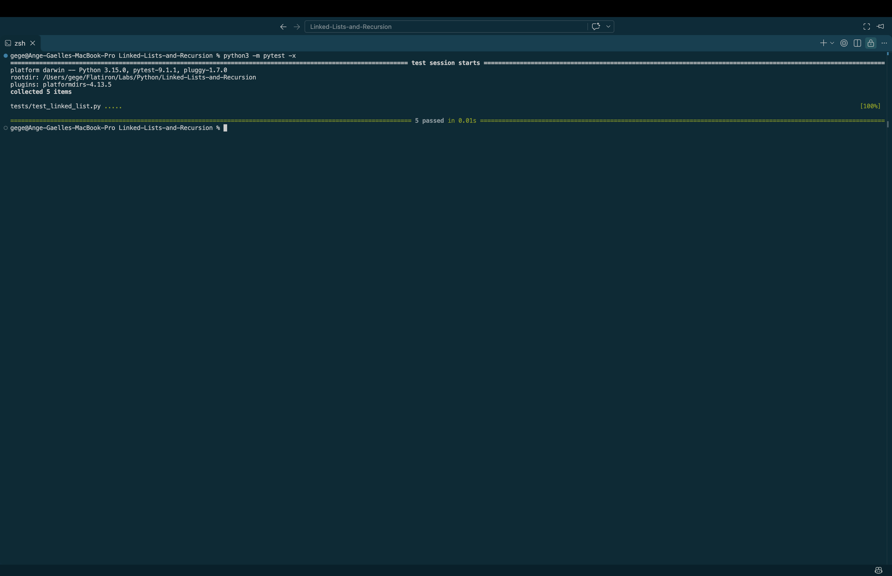

# Linked Lists and Recursion

## Project Overview

This project demonstrates how to build and manipulate a singly linked list in Python using recursion.

The application supports inserting nodes, calculating the sum of node values, searching for a specific value, and reversing the linked list in place.

## Technologies Used

- Python 3
- Object-Oriented Programming (OOP)
- Recursion
- Pytest
- Git and GitHub

## Features

### 1. Node Creation

The `Node` class represents an individual element in the linked list.

Each node contains:

- `data`: An integer value stored in the node.
- `next`: A reference to the next node, initially set to `None`.

### 2. Linked List Creation

The `LinkedList` class manages the nodes using a `head` reference.

An empty linked list starts with `head = None`.

### 3. Insert at Front

The `insert_at_front(data)` method adds a new node at the beginning of the linked list.

**Example:**

```text
10 -> 20 -> 30 -> None
```

### 4. Insert at End

The `insert_at_end(data)` method adds a new node at the end of the linked list.

If the list is empty, the new node becomes the head.

### 5. Recursive Sum

The `recursive_sum()` method calculates the sum of all node values using recursion.

**Base case:** Return `0` when the current node is `None`.

**Recursive case:** Add the current node's data to the sum of the remaining nodes.

**Example:**

```text
10 + 20 + 30 = 60
```

### 6. Recursive Search

The `recursive_search(target)` method searches for a specified value in the linked list.

- Returns `True` when the target is found.
- Returns `False` when the target is not found.
- Returns `False` for an empty list.

### 7. Recursive Reverse

The `recursive_reverse()` method reverses the linked list in place by updating each node's `next` reference.

**Before:**

```text
10 -> 20 -> 30 -> None
```

**After:**

```text
30 -> 20 -> 10 -> None
```

The method updates the head to point to the first node of the reversed list.

### 8. Display Linked List

The `display()` method prints the linked list in a readable format.

**Example:**

```text
10 -> 20 -> 30 -> None
```

## Installation and Setup

### 1. Clone the Repository

```bash
git clone git@github.com:a-gbatie/Linked-Lists-and-Recursion.git
```

### 2. Navigate to the Project Directory

```bash
cd Linked-Lists-and-Recursion
```

### 3. Run the Application

```bash
python3 main.py
```

## Running Tests

This project uses Pytest to verify linked list functionality.

Run all tests:

```bash
python3 -m pytest
```

To stop testing after the first failure:

```bash
python3 -m pytest -x
```

## Screenshot of Completed Tests

The following screenshot shows the successful execution of the automated tests.
